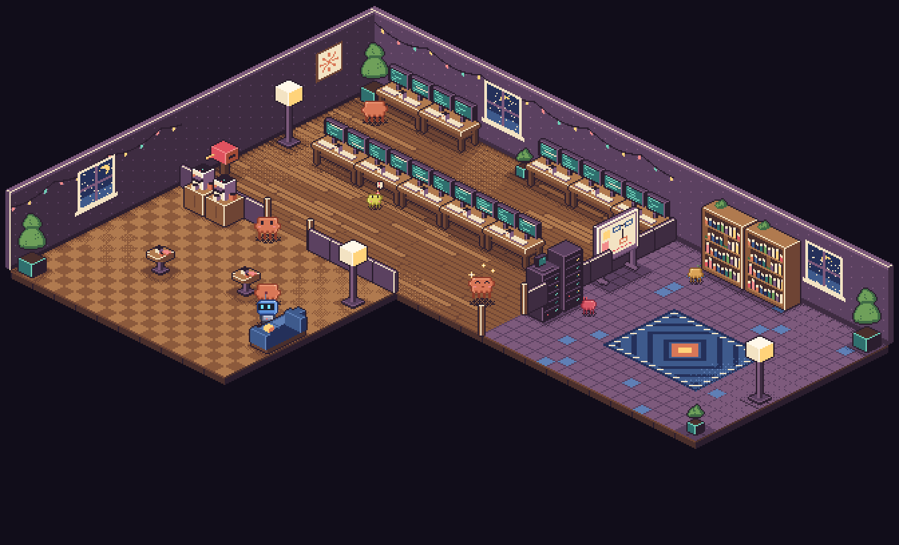
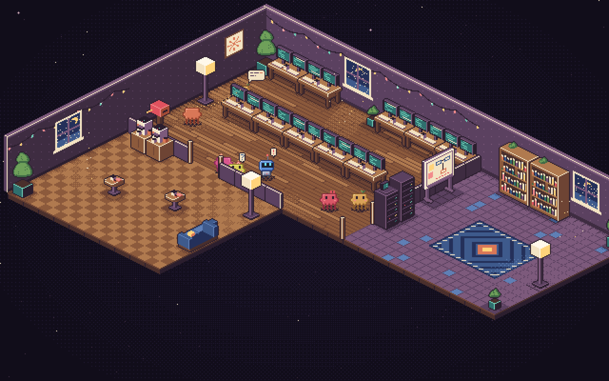
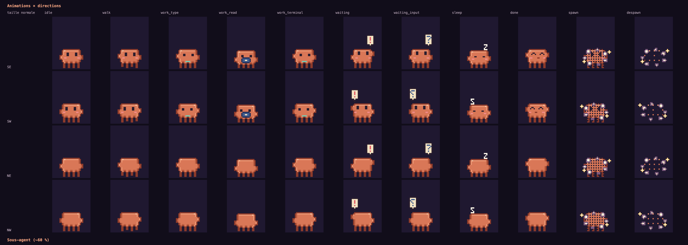

# Agent Office

Écran de veille macOS en pixel art isométrique : un petit bureau de nuit où chaque session Claude Code (et chaque sous-agent) est un personnage qui se déplace vers le poste correspondant à l'outil qu'il utilise.



- **Monde en L** : open space (18 bureaux), labo (bibliothèque, serveurs, tableau blanc, fenêtre), cafétéria (café, tables, canapé), séparés par des cloisons basses avec portes.
- **Mascotte « Clawd »** (corail) ; sous-agents en version mini, teinte + accessoire par instance ; 2ᵉ personnage de démo « Bolt » (robot bleu).
- **Lisible d'un coup d'œil** : chaque état d'une session a son propre sprite (voir [États des agents](#états-des-agents)) ; bulles à faux texte = discussion (briefing, rapport, pause café).
- **Rendu** : sprites 100 % procéduraux (aucune image), palette de 24 couleurs, scale entier (pixels nets), 30 fps max, zéro rendu quand l'écran est caché.

## États des agents



| État | Ce qu'on voit | Déclencheur (hook Claude Code) |
|---|---|---|
| Travaille | à un poste, animation selon l'outil (frappe, lecture, terminal…) | `PreToolUse` |
| Bloqué : permission | bulle **« ! » rouge**, le robot allume son ampoule | `PermissionRequest`, `Notification` (permission) |
| Attend ta consigne | bulle **« ? » bleue** | `Notification` de type `idle_prompt` |
| Inactif | se promène, discute, va à la cafétéria ; après ~25 s de repos, il **s'endort** (« z » qui monte) | aucun événement |
| Terminé | petit saut de victoire avec étincelles, puis pause | `Stop` |
| Sous-agent | version mini, teinte propre, relié à son parent | `Task` / `Agent`, `SubagentStart` |
| Apparition / départ | nuage de pixels | `SessionStart` / `SessionEnd` |

Un agent en attente (« ! » ou « ? ») reprend le travail dès son prochain outil ou dès que tu envoies un nouveau prompt.



La galerie (`/gallery`) montre chaque animation dans les 4 directions, pour les deux personnages et leur version mini.

## Lancer

```bash
pnpm install
```

```bash
pnpm dev
```

Puis ouvrir http://localhost:4317 (scène) et http://localhost:4317/gallery (galerie de tous les sprites, animations, meubles, bulles).
En dev, une **démo** tourne toute seule et s'arrête dès qu'un vrai événement arrive (`DEMO=0 pnpm dev` pour la couper).

| Commande | Effet |
|---|---|
| `pnpm dev` | serveur (Vite en middleware) + WebSocket `/events` + `POST /hook` sur le port 4317 (`PORT=…`) |
| `pnpm sim` | joue le scénario scripté vers le serveur (`--random`, `--stress 30`, `--speed 2`) |
| `pnpm build && pnpm start` | version de production (sert `dist/`) |
| `pnpm test` | tests unitaires (Vitest) |
| `pnpm test:visual` | tests navigateur (Playwright ; `npx playwright install chromium` la première fois) |
| `pnpm perf` | mesure FPS/CPU sur 5 min → `docs/qa/perf.json` |

Sans serveur : `/?mock=1` (scénario scripté puis aléatoire), `/?mock=random`, `/?mock=stress&n=30`, avec `&speed=3` pour accélérer.

## Architecture

```
shared/          contrat partagé front/back
  events.ts        AgentEvent + Snapshot (zod)
  tool-stations.json  outil → type de poste → animation
  scenario.ts      scénarios scripté / aléatoire / stress (simulateur et ?mock)
server/          Node (tsx)
  index.ts         HTTP + WebSocket /events + POST /hook + POST /events + démo
  hook-adapter.ts  payload hook Claude Code → AgentEvent
  tracker.ts       agents vivants, rejoués (snapshot) à chaque (re)connexion
src/engine/      moteur générique (ne connaît aucun personnage)
  bitmap, shape, isoPaint   pixels, masques auto-ombrés, primitives iso
  iso.ts           projection 2:1 (tuile 32×16) + tri de profondeur topologique
  pathfinding.ts   A* 4-connexe + murs fins (cloisons)
  agent.ts         position, déplacement, animation d'un agent
  sprite.ts        CharacterDefinition → frames pré-rendues (miroirs, teinte, poof générique)
  loop.ts          boucle rAF plafonnée à 30 fps, arrêtée si document.hidden
src/characters/  un fichier par personnage + registry + kinds.json
src/world/       palette, meubles, plan du bureau (layout.ts), rendu statique
src/scene/       simulation (office.ts), compositeur, caméra, ambiance, bulles
```

La simulation (`src/scene/office.ts`) est de la logique pure, testée avec une horloge factice. Cycle de vie d'un agent :
`spawning → idle ⇄ walking → working ⇄ waiting → done → (returning) → despawning`.

## Format des événements

```ts
type AgentEvent =
  | { type: "agent_spawn"; agentId: string; parentId?: string; kind: AgentKind; label?: string }
  | { type: "agent_tool"; agentId: string; tool: string; summary?: string }
  | { type: "agent_waiting"; agentId: string; reason?: string; need?: "permission" | "input" }
  | { type: "agent_done"; agentId: string }
  | { type: "agent_despawn"; agentId: string };
```

- `agent_waiting` : `need: "permission"` (par défaut, « ! » rouge) ou `"input"` (« ? » bleu, l'agent attend ton prochain message).
- `AgentKind` : `"claude"` aujourd'hui (et `"robot"` pour la démo). N'importe quelle chaîne est acceptée ; un type inconnu prend le personnage par défaut.
- Envoi direct : `POST /events` avec un `AgentEvent` (ou un tableau). Réponse `202`, ou `400` si invalide.
- Côté écran, le WebSocket `ws://host/events` reçoit les `AgentEvent`, et d'abord un `{ type: "snapshot", agents: [...] }` qui resynchronise l'écran après une (re)connexion. La reconnexion est automatique (1 s → 10 s).
- Robustesse : un événement pour un agent inconnu le crée (`agent_tool`, `agent_waiting`) ou est ignoré (`agent_done`, `agent_despawn`) ; un double `agent_done` est sans effet ; les sous-agents disparaissent avec leur parent.

```bash
curl -X POST localhost:4317/events -H 'content-type: application/json' -d '{"type":"agent_spawn","agentId":"demo","kind":"claude"}'
```

```bash
curl -X POST localhost:4317/events -H 'content-type: application/json' -d '{"type":"agent_tool","agentId":"demo","tool":"Bash","summary":"pnpm test"}'
```

## Ajouter un personnage

1. Créer `src/characters/monperso.ts` qui exporte une `CharacterDefinition` (voir `robot.ts`, ~150 lignes) :
   palette, couleurs non teintées (`fixedColors`), tailles `full` / `mini` (cadre, ancrage des pieds, ombre, tête), animations (réutiliser `STANDARD_ANIMATIONS` et `poseFor()` de `pose.ts` pour le même « feel »), une fonction `draw(bitmap, ctx)` qui dessine une frame de face (SE) ou de dos (NE), et des préférences de pause (`idlePreferences`).
2. L'enregistrer dans `src/characters/index.ts` : `.register(MON_PERSO)`.
3. Associer un `AgentKind` dans `src/characters/kinds.json` : `"codex": "monperso"`.

Le moteur fournit les miroirs SW/NW, les variantes par instance (teinte, accessoire), le poof de spawn/despawn, l'ombre, les bulles et le tri de profondeur. Pour passer plus tard à des spritesheets PNG, il suffit que `draw` copie les pixels d'une image dans le `Bitmap` fourni.

## Ajouter un poste, un meuble ou une pièce

- **Meuble** : une `FurnitureDef` dans `src/world/furniture.ts` (emprise en tuiles, `draw(painter, palette, frame)` avec `box` / `planeX` / `planeY` / `planeZ`). Il apparaît dans la galerie via `ALL_FURNITURE`.
- **Poste** : dans `src/world/layout.ts`, `put(MEUBLE, x, y)` puis `station(id, type, pièce, [{ x, y, dir }])` (cases où se placent les agents et leur orientation). Plusieurs emplacements par poste ; quand ils sont tous pris, les agents attendent à côté.
- **Type de poste / outil** : `shared/tool-stations.json` (`tools` exacts, `prefixes` comme `mcp__`, `animations` par type de poste).
- **Pièce** : ajouter un `Room` (position, taille, sol `planks` | `tiles` | `checker`, tapis optionnel), les `partitions` avec leurs `doors`, et éventuellement `windows` / `posters` / `fairyLights` / `lamps`. Le moteur, le tri de profondeur, l'A* et la caméra s'adaptent tout seuls.

## Étape suivante : brancher Claude Code

Le serveur accepte déjà les payloads bruts des hooks sur `POST /hook` (correspondance détaillée dans `server/hook-adapter.ts`) :

| Hook | Effet à l'écran |
|---|---|
| `SessionStart`, `UserPromptSubmit` | la session apparaît (bureau attitré) ; `UserPromptSubmit` sort aussi un agent de l'attente |
| `PreToolUse` | l'agent va au poste de l'outil ; `Task` / `Agent` fait apparaître un sous-agent |
| `PostToolUse` (Task), `SubagentStop` | le sous-agent revient faire son rapport puis disparaît |
| `PermissionRequest`, `Notification` | bulle « ! » (permission demandée) ; `Notification` de type `idle_prompt` : bulle « ? » (attend ta consigne). L'outil ou le prompt suivant le remet au travail |
| `SubagentStart` | associe l'`agent_id` du sous-agent (ses outils s'affichent sur lui) |
| `Stop` | petit saut de victoire, puis pause café |
| `SessionEnd` | la session disparaît |

Installation automatique (fusionne avec les hooks existants, idempotente, sauvegarde horodatée du fichier) :

```bash
node scripts/claude-hooks.mjs install
```

`node scripts/claude-hooks.mjs status` / `uninstall`. Les hooks sont pris en compte par les sessions déjà ouvertes à leur prochain événement. Le script ajoute aussi `PermissionRequest`, `PostToolUseFailure`, `StopFailure` et `SubagentStart`, gérés par l'adaptateur.

Équivalent manuel (minimal) dans `~/.claude/settings.json`, qui couvre toutes les sessions Claude Code, terminal comme app desktop :

```json
{
  "hooks": {
    "SessionStart":     [{ "hooks": [{ "type": "command", "command": "curl -s -m 1 -X POST http://localhost:4317/hook -H 'content-type: application/json' --data-binary @- >/dev/null || true" }] }],
    "UserPromptSubmit": [{ "hooks": [{ "type": "command", "command": "curl -s -m 1 -X POST http://localhost:4317/hook -H 'content-type: application/json' --data-binary @- >/dev/null || true" }] }],
    "PreToolUse":       [{ "matcher": "*", "hooks": [{ "type": "command", "command": "curl -s -m 1 -X POST http://localhost:4317/hook -H 'content-type: application/json' --data-binary @- >/dev/null || true" }] }],
    "PostToolUse":      [{ "matcher": "Task|Agent", "hooks": [{ "type": "command", "command": "curl -s -m 1 -X POST http://localhost:4317/hook -H 'content-type: application/json' --data-binary @- >/dev/null || true" }] }],
    "Notification":     [{ "hooks": [{ "type": "command", "command": "curl -s -m 1 -X POST http://localhost:4317/hook -H 'content-type: application/json' --data-binary @- >/dev/null || true" }] }],
    "Stop":             [{ "hooks": [{ "type": "command", "command": "curl -s -m 1 -X POST http://localhost:4317/hook -H 'content-type: application/json' --data-binary @- >/dev/null || true" }] }],
    "SubagentStop":     [{ "hooks": [{ "type": "command", "command": "curl -s -m 1 -X POST http://localhost:4317/hook -H 'content-type: application/json' --data-binary @- >/dev/null || true" }] }],
    "SessionEnd":       [{ "hooks": [{ "type": "command", "command": "curl -s -m 1 -X POST http://localhost:4317/hook -H 'content-type: application/json' --data-binary @- >/dev/null || true" }] }]
  }
}
```

Le hook reçoit le JSON de l'événement sur stdin ; `curl --data-binary @-` le transmet tel quel. `-m 1` et `|| true` garantissent qu'un écran éteint ne ralentit ni ne bloque jamais Claude Code.

À vérifier lors de l'intégration :
- les appels d'outils faits *dans* un sous-agent sont attribués au sous-agent via l'`agent_id` reçu au `SubagentStart` ; sans `agent_id`, ils s'affichent sur l'agent de la session ;
- l'app Claude Desktop (chat) n'a pas de hooks : seules les sessions Claude Code, y compris celles de l'app desktop, sont visibles.

## Écran de veille macOS

1. Lancer le serveur au login (LaunchAgent `com.agent-office.server`, relancé automatiquement, logs dans `~/Library/Logs/agent-office.log`) :

   ```bash
   scripts/launchagent.sh install
   ```

   `scripts/launchagent.sh status` / `uninstall` ; relancer `install` après une mise à jour du code (si le `bootstrap` échoue juste après le `bootout`, relancer la commande). `DEMO=0 scripts/launchagent.sh install` désactive la démo.

2. Installer l'économiseur (recommandé : le `.saver` léger, testé sur macOS 26) :

   ```bash
   saver/legacy/build.sh
   ```

3. Réglages Système → Fond d'écran → Économiseur d'écran → **AgentOffice** (sans espace). Après une reconstruction : `killall legacyScreenSaver ScreenSaverEngine`.

Le `.saver` n'embarque qu'un `WKWebView` qui affiche `http://localhost:4317/` : les changements de l'interface (`pnpm build`) sont pris en compte sans le reconstruire. Il neutralise la détection d'occlusion de WebKit, sinon la page est considérée comme cachée et clignote / devient noire, et pilote les frames à la main (voir [`saver/README.md`](saver/README.md)).

Il existe aussi une variante app extension (`saver/install.sh`, « Agent Office » avec espace), plus proche des économiseurs Apple mais moins testée.

**Mac gérés par MDM** : si un profil impose l'économiseur (`moduleName` dans `/Library/Managed Preferences/com.apple.screensaver.plist`), macOS lance celui-ci en plein écran quel que soit le choix dans les Réglages. Il faut demander à l'administrateur de retirer cette clé.

La page est déjà en mode écran de veille : plein écran, curseur masqué, aucune interaction, fond sombre, scale entier automatique, rendu arrêté quand la page est cachée.

## Qualité

- `docs/art-direction.md` : charte (palette, lumière, contours, proportions, décisions de design).
- `docs/qa-report.md` : critères d'acceptation, résultats des tests, mesures de performance, bugs trouvés et corrigés.
- `docs/screenshots/` : captures de chaque jalon et de la QA (4 résolutions).

## Contribuer

Le projet est ouvert à tous : issues et pull requests bienvenues. Pistes faciles : un nouveau personnage (`src/characters/`), un meuble ou une pièce (`src/world/`), de nouveaux états visuels, la prise en charge d'autres agents de code (envoie des `AgentEvent` sur `POST /events`).

Avant d'ouvrir une PR :

```bash
pnpm typecheck && pnpm test
```

et vérifier le rendu dans la galerie (`pnpm dev` puis `/gallery`) ; `pnpm test:visual` lance les tests navigateur.

Hors périmètre actuel : interactions souris, sons, persistance, authentification (le serveur n'a pas d'authentification : ne l'expose pas sur Internet).

## Licence

[MIT](LICENSE). Le dossier `saver/` reprend un modèle d'économiseur sous licence MIT (voir `saver/LICENSE`).
